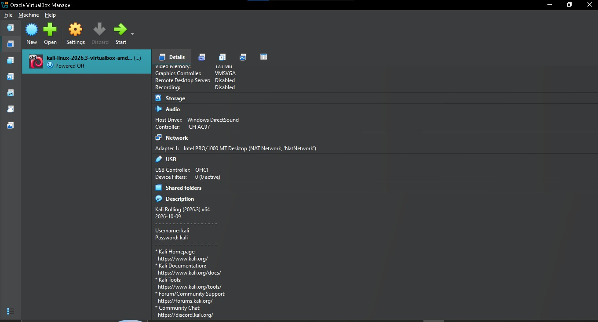
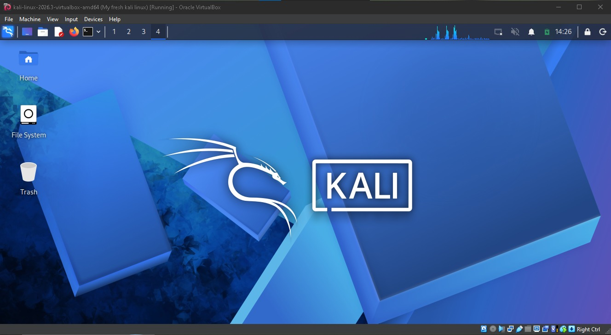

# Cybersecurity Lab Setup

**Name:** Daniel Nwabueze
**Project:** Week 1, Project Module 1

## Overview
This project documents how I set up a cybersecurity lab on my computer using virtualization. The lab gives me a safe environment to practice security skills.

## Tools Used
- VirtualBox
- Kali Linux

## Steps

### Step 1: Install VirtualBox
I downloaded VirtualBox from the official website and installed it on my computer. VirtualBox lets me run a separate operating system inside my main one.

### Step 2: Create and run the Kali Linux virtual machine
I created a new virtual machine in VirtualBox and installed Kali Linux, a system built for security testing. The screenshot shows the VM running.

## Challenges and Solutions

**Challenge:** After starting the Kali Linux VM, the network showed as disconnected and I had no internet access. The VM was not automatically receiving network settings.

**Solution:** I configured the network connection manually:
1. Right-clicked the network icon and selected **Edit Connections**.
2. Opened the **Wired connection** and went to the **IPv4 Settings** tab.
3. Set the method to **Manual** and entered:
   - Address: 10.0.0.0
   - Netmask: 24
   - Gateway: 10.0.0.1
   - DNS servers: 10.0.0.1
4. Saved the settings and reconnected.

**Result:** The VM connected successfully. A static IP gave Kali a valid address, the gateway gave it a route to the internet, and the DNS server allowed it to resolve website names.

**What I learned:** Devices need an IP address, a gateway, and DNS to communicate beyond the local network, and these can be set manually when automatic assignment (DHCP) fails.

Describe any problem you faced and how you fixed it.

## Conclusion
I now have a working lab environment where I can practice cybersecurity skills safely.
